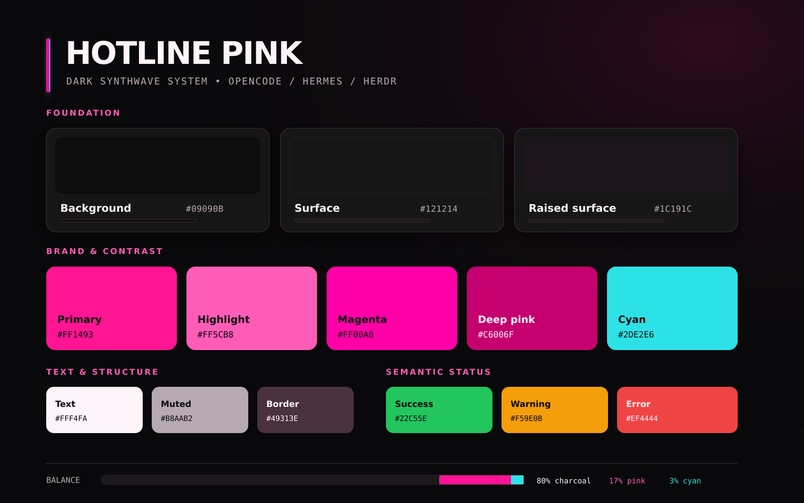
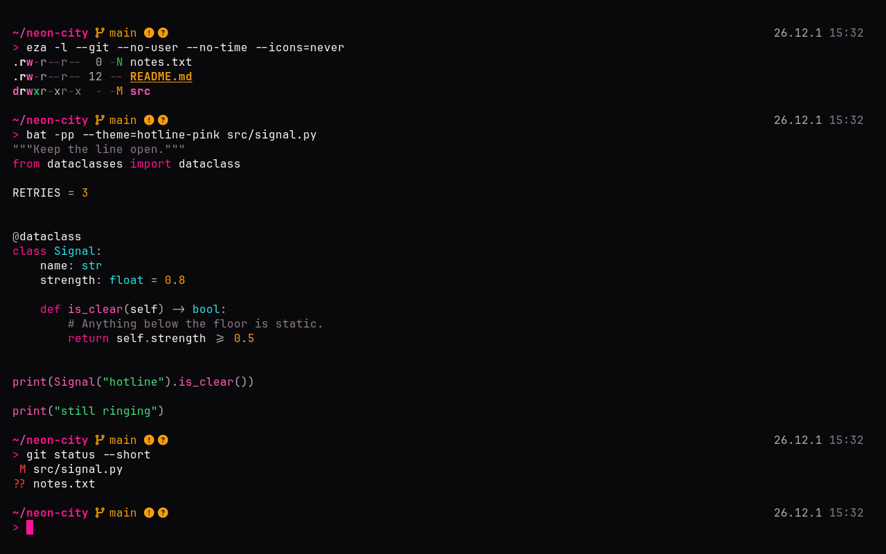
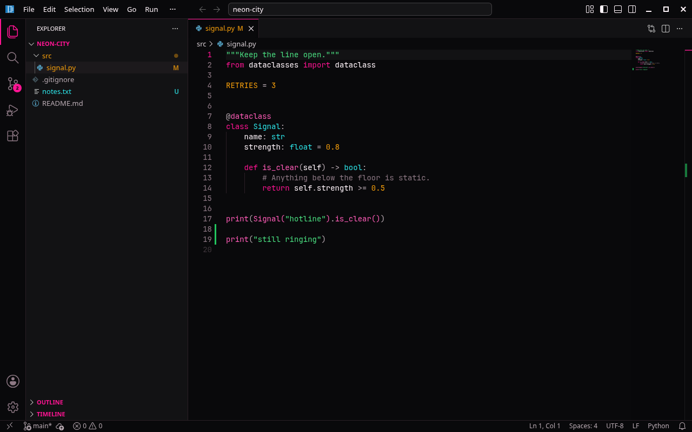

# Hotline Pink

A dark synthwave theme for terminals, shells, TUI tools, editors and KDE: charcoal surfaces, hot pink accents and a touch of cyan.







## Quick start

See what's available:

```bash
./install.py --list
```

Preview an install, then run it:

```bash
./install.py ghostty fish --dry-run
```

```bash
./install.py ghostty fish
```

Use `--all` for every app. The installer needs Python 3.11 or newer and nothing else.

The installer only adds theme files, and it backs up anything it would replace. It never edits your own configs, so each app prints the step that turns the theme on. You can also skip the installer and copy files from `apps/<app>/` yourself.

Terminal colours set no font. JetBrains Mono Nerd Font is the recommended match, and the Powerlevel10k prompt needs a Nerd Font.

## Uninstall

```bash
./install.py --uninstall ghostty fish
```

This removes the theme files and puts your backups back. Files you edited after installing are kept unless you pass `--force`. Tide colours are restored too, except any you changed yourself since applying the theme.

Lines you added to your own configs, such as `theme = hotline-pink`, are yours to revert. The uninstaller prints them for each app.

## Supported apps

"Loaded in the app" means the theme was opened in that app and the result looked right. "Syntax checked only" means the file was parsed or validated, but not yet seen running.

<!-- apps:start -->
| Group | App | Install | Status |
|---|---|---|---|
| Terminals | [Ghostty](apps/ghostty/) | `./install.py ghostty` | Loaded in the app |
| Terminals | [Konsole](apps/konsole/) | `./install.py konsole` | Loaded in the app |
| Terminals | [Alacritty](apps/alacritty/) | `./install.py alacritty` | Syntax checked only |
| Terminals | [Microsoft Terminal](apps/windows-terminal/) | manual | Syntax checked only |
| Shells | [zsh + Powerlevel10k](apps/zsh-p10k/) | `./install.py zsh-p10k` | Loaded in the app |
| Shells | [fish + Tide](apps/fish/) | `./install.py fish` | Syntax checked only |
| TUI tools | [btop](apps/btop/) | `./install.py btop` | Syntax checked only |
| TUI tools | [bat](apps/bat/) | `./install.py bat` | Loaded in the app |
| TUI tools | [delta](apps/delta/) | `./install.py delta` | Syntax checked only |
| TUI tools | [fzf](apps/fzf/) | `./install.py fzf` | Syntax checked only |
| TUI tools | [eza](apps/eza/) | `./install.py eza` | Loaded in the app |
| TUI tools | [micro](apps/micro/) | `./install.py micro` | Syntax checked only |
| TUI tools | [superfile](apps/superfile/) | `./install.py superfile` | Syntax checked only |
| Editors | [VS Code / Cursor](apps/vscode/) | `./install.py vscode` | Loaded in the app |
| Editors | [Kate](apps/kate/) | `./install.py kate` | Loaded in the app |
| Editors | [JetBrains IDEs](apps/jetbrains/) | manual | Syntax checked only |
| Desktop | [KDE Plasma](apps/kde-plasma/) | `./install.py kde-plasma` | Syntax checked only |
| Agent tools | [opencode](apps/opencode/) | `./install.py opencode` | Syntax checked only |
| Agent tools | [herdr](apps/herdr/) | manual | Syntax checked only |
<!-- apps:end -->

## Repo layout

| Path | What it holds |
|---|---|
| `base/` | The palette, usage rules, app registry, templates and generator |
| `apps/<app>/` | Generated config files and install notes, one folder per app |
| `install.py` | Installer and uninstaller |

## Changing the theme

Files in `apps/` are generated, so edit `base/palette.json` or a template in `base/templates/`, then run:

```bash
base/generate.py
```

```bash
base/generate.py --check
```

The check fails if `apps/` is out of date, if an ANSI or syntax colour drops below 4.5:1 on the background, or if a `#RRGGBB` colour isn't in the palette.

To add an app, create `base/templates/<app>/` and add a table for it to `base/apps.toml`.

## License

[MIT](LICENSE)
