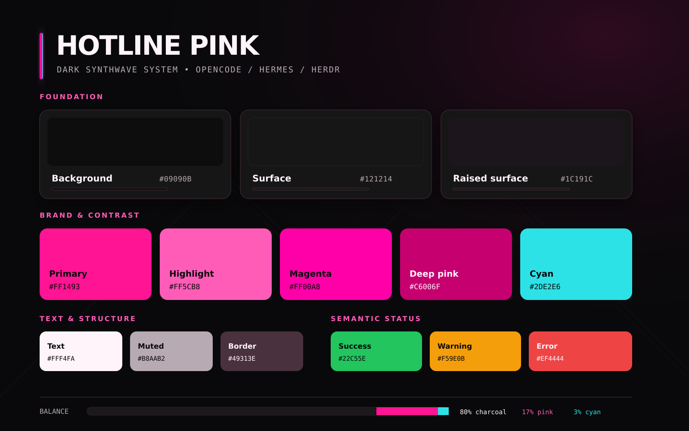

# Theme concept

Hotline Pink is dark only. The neon is an accent, not the wallpaper.

**The balance is about 80% charcoal, 17% pink and 3% cyan.** If a screen looks pink, it's too pink.

## Colours

`palette.json` is the single source of truth. Its three sections are:

- `canonical`: the design system's colours.
- `derived`: colours added for terminals and editors, which the design system doesn't define.
- `roles`: what each ANSI and syntax slot points to.

### Canonical

| Token | Value | Use |
|---|---|---|
| `bg` | `#09090B` | Main background |
| `surface` | `#121214` | Panels and sidebars |
| `raised` | `#1C191C` | The one panel that should draw the eye, plus hover and active rows |
| `primary` | `#FF1493` | Small, sharp accents: keywords, active markers, the main button |
| `highlight` | `#FF5CB8` | Links, functions, button hover |
| `magenta` | `#FF00A8` | Background glow only, never text |
| `deep` | `#C6006F` | Gradient ends and fills, never text on `bg` |
| `cyan` | `#2DE2E6` | Focus rings and tiny highlights |
| `text` | `#FFF4FA` | Body text |
| `muted` | `#B8AAB2` | Secondary text |
| `border` | `#49313E` | Lines and selections, never text |
| `border-soft` | `#2A1F26` | Hairlines |
| `success` | `#22C55E` | Success |
| `warning` | `#F59E0B` | Warnings |
| `error` | `#EF4444` | Errors |

### ANSI mapping

| Colour | Normal | Bright |
|---|---|---|
| Black | `raised` | `index` `#8E7985` |
| Red | `error` | `#FF7A7A` |
| Green | `success` | `#4ADE80` |
| Yellow | `warning` | `#FBBF24` |
| Blue | `#6E8BFF` | `#A0B2FF` |
| Magenta | `primary` | `highlight` |
| Cyan | `cyan` | `#8AF3F5` |
| White | `muted` | `text` |

The palette has no blue, but terminal programs expect one, so `#6E8BFF` fills the slot.

### Syntax roles

| Role | Colour |
|---|---|
| Keywords | `primary` |
| Functions | `highlight` |
| Types | `cyan` |
| Strings | `#4ADE80` |
| Numbers and constants | `warning` |
| Comments | `index` |
| Variables | `text` |
| Punctuation and operators | `muted` |

Terminal UI colours are a `primary` cursor and a `border` selection with `text` on top.

### Exception to the balance

Inside a terminal or editor, programs choose the colours, so ANSI cyan and syntax types can go past 3% cyan. That's accepted here. The rule still applies to UI chrome, where cyan stays on focus rings and small status marks.

## Contrast on `bg`

| Colour | Ratio |
|---|---|
| `text` | 18.5:1 |
| `cyan` | 12.4:1 |
| `#4ADE80` | 11.4:1 |
| `warning` | 9.3:1 |
| `muted` | 8.9:1 |
| `success` | 8.7:1 |
| `highlight` | 7.1:1 |
| `#6E8BFF` | 6.4:1 |
| `primary` | 5.5:1 |
| `error` | 5.3:1 |
| `index` | 4.9:1 |
| `deep` | 3.4:1, not for text |
| `border` | 1.7:1, not for text |

`generate.py --check` enforces at least 4.5:1 for every ANSI and syntax colour except ANSI black, which is a surface colour.

## Generating configs

`generate.py` renders `templates/<app>/` into `apps/<app>/` and writes each app's README and the root apps table from `apps.toml`.

| Placeholder | Output |
|---|---|
| `{{primary}}` | `#FF1493` |
| `{{primary.lower}}` | `#ff1493` |
| `{{primary.bare}}` | `FF1493` |
| `{{primary.rgb}}` | `255,20,147` |
